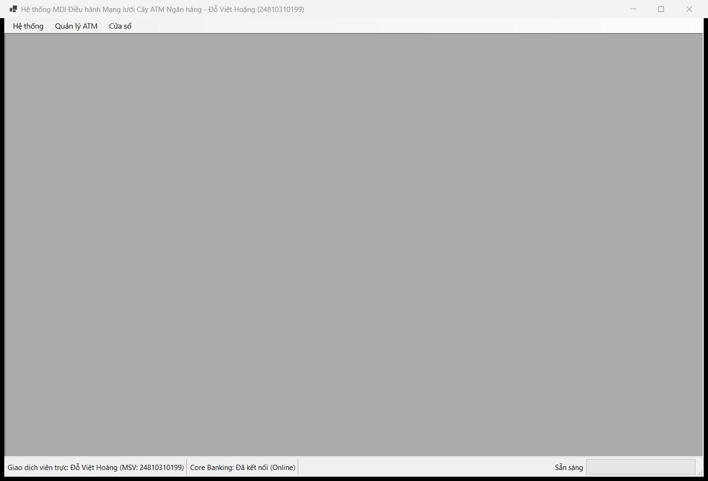
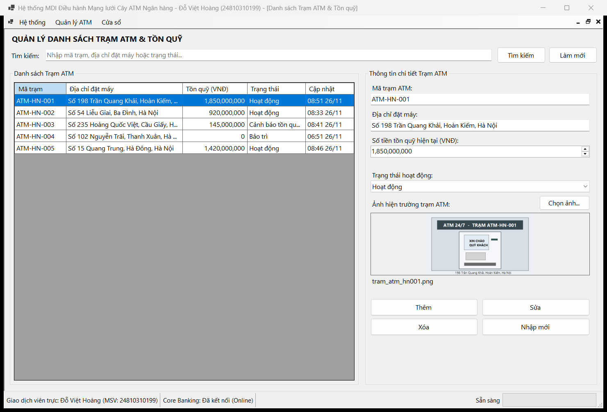
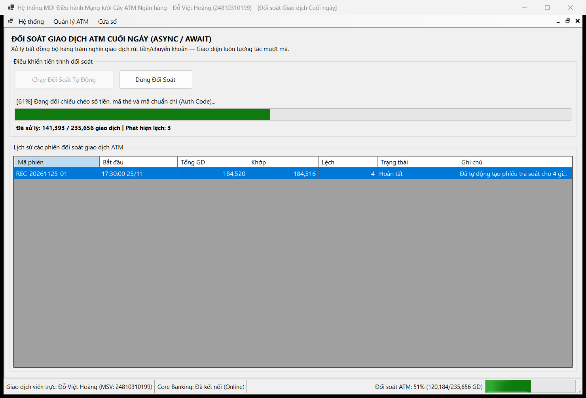
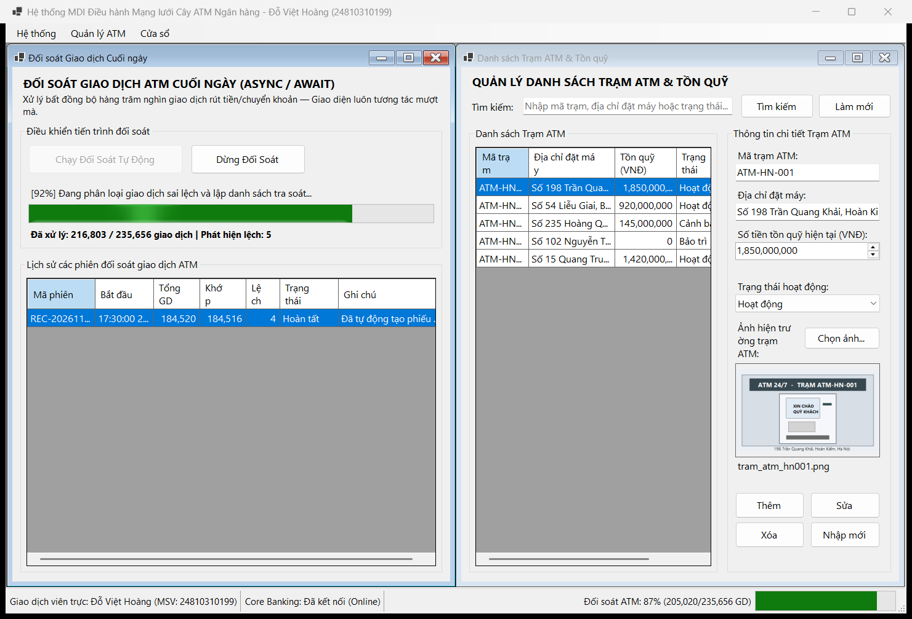
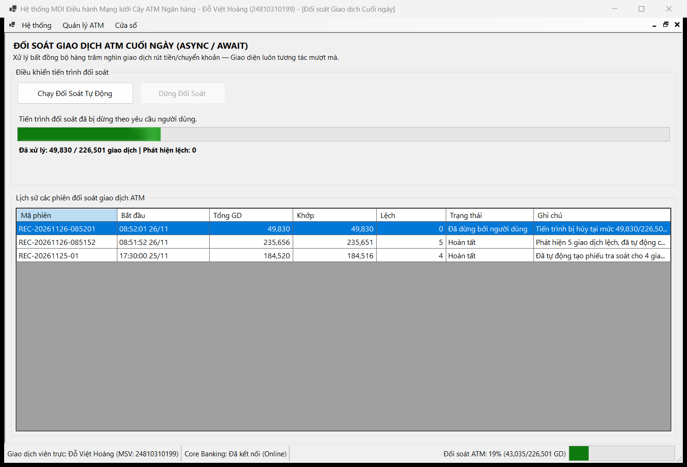

# BÀI TẬP 6.6: HỆ THỐNG MDI ĐIỀU HÀNH MẠNG LƯỚI CÂY ATM NGÂN HÀNG

## Thông tin sinh viên
- **Họ và tên:** Ngô Mạnh Dũng
- **Mã sinh viên (MSV):** `24810310194`
- **Chủ đề:** Kiến trúc MDI (`IsMdiContainer`) & Lập trình Bất đồng bộ (`async`/`await`, `Task.Run`, `CancellationTokenSource`)

---

## 1. Mục tiêu kiến thức
- Xây dựng kiến trúc giao diện đa cửa sổ **MDI** (`IsMdiContainer = true`) quản lý các phân hệ nghiệp vụ ngân hàng.
- Ngăn chặn hành vi mở trùng lặp (**Duplicate**) Form con khi nhấn Menu nhiều lần thông qua duyệt danh sách `this.MdiChildren` và gọi `Activate()`.
- Áp dụng `async`/`await`, `Task.Run`, `Task.Delay`, `IProgress<T>` và `CancellationTokenSource` để chạy tác vụ đối soát hàng trăm nghìn giao dịch ATM cuối ngày mà không làm treo giao diện (**UI Thread**).

---

## 2. Cấu trúc Solution 3-Tier

```text
Bai6_6_HeThongMDI_ATM/
├── Bai6_6_HeThongMDI_ATM.sln
├── Database/
│   └── ScriptDB.sql                      # Script tạo CSDL BankAtmManagementDB và dữ liệu mẫu
├── DTO/
│   ├── AtmStationDTO.cs                  # Thông tin Trạm ATM & Tồn quỹ
│   └── ReconciliationLogDTO.cs           # Kết quả & tiến độ đối soát giao dịch
├── DAL/
│   ├── AtmStationDAL.cs                  # Truy xuất dữ liệu Trạm ATM
│   └── ReconciliationDAL.cs              # Lưu trữ lịch sử phiên đối soát
├── BUS/
│   ├── AtmStationBUS.cs                  # Nghiệp vụ kiểm tra hợp lệ, CRUD, tìm kiếm Trạm ATM
│   └── ReconciliationBUS.cs              # Động cơ đối soát bất đồng bộ (Task.Run + Task.Delay)
├── GUI/
│   ├── frmBankAtmMain.cs                 # Form Cha MDI (MenuStrip, StatusStrip, ToolStripProgressBar)
│   ├── frmAtmStations.cs                 # Form Con 1: Danh sách Trạm ATM, Tồn quỹ & OpenFileDialog
│   └── frmAtmReconciliation.cs           # Form Con 2: Đối soát Giao dịch Cuối ngày (Async/Await)
├── Images/                               # 5 ảnh chụp màn hình chức năng
└── README.md
```

---

## 3. Chức năng đã triển khai

### 3.1. Form Cha MDI (`frmBankAtmMain`)
- Thiết lập `IsMdiContainer = true`.
- **MenuStrip**:
  - **Hệ thống:** `Đăng xuất`, `Khóa màn hình` (`Ctrl+L`), `Thoát` (`Alt+F4`).
  - **Quản lý ATM:** `Danh sách Trạm ATM & Tồn quỹ` (`Ctrl+1`), `Đối soát Giao dịch Cuối ngày` (`Ctrl+2`).
  - **Cửa sổ:** `Xếp tầng (Cascade)`, `Xếp ngang (Tile Horizontal)`, `Xếp dọc (Tile Vertical)`, `Đóng tất cả`.
- **StatusStrip:** Hiển thị tên giao dịch viên trực (`Đỗ Việt Hoàng - MSV: 24810310199`), trạng thái kết nối **Core Banking**, thông tin tiến trình và thanh tiến trình `ToolStripProgressBar`.
- **Chống mở trùng Form con:** Hàm `OpenOrActivateChild<T>()` kiểm tra `this.MdiChildren`; nếu đã mở thì khôi phục trạng thái và gọi `Activate()`.

### 3.2. Form Con 1 — Quản lý Trạm ATM & Tồn quỹ (`frmAtmStations`)
- Quản lý đầy đủ: Mã trạm, Địa chỉ đặt máy, Số tiền tồn quỹ hiện tại (VNĐ), Trạng thái hoạt động, Thời gian cập nhật.
- Hỗ trợ Thêm, Sửa, Xóa, Tìm kiếm và hiển thị chi tiết trạng thái hoạt động, số tiền tồn quỹ.
- Sử dụng `OpenFileDialog` để chọn và hiển thị ảnh chụp hiện trường trạm ATM trực tiếp trên `PictureBox`.

### 3.3. Form Con 2 — Đối soát Giao dịch Cuối ngày (`frmAtmReconciliation`)
- Gồm hai nút chức năng: **[Chạy Đối Soát Tự Động]** và **[Dừng Đối Soát]**.
- Giả lập tải và đối chiếu ~180.000 – 260.000 giao dịch rút tiền/chuyển khoản trong 4,5 – 5,8 giây bằng `await Task.Run(...)` kết hợp `Task.Delay`.
- Đồng bộ tiến độ theo thời gian thực lên cả thanh tiến trình cục bộ lẫn `ToolStripProgressBar` trên Form cha MDI.
- Trong lúc đang đối soát, người dùng vẫn có thể mở `frmAtmStations`, kéo thả, xếp tầng/xếp ngang/xếp dọc cửa sổ mượt mà, không xảy ra hiện tượng *Not Responding*.

---

## 4. Hướng dẫn cài đặt & chạy ứng dụng

1. *(Tùy chọn CSDL)* Chạy tệp `Database/ScriptDB.sql` trên SQL Server Management Studio để khởi tạo cơ sở dữ liệu mẫu.
2. Mở `Bai6_6_HeThongMDI_ATM.sln` bằng Visual Studio 2022, chọn `AtmManagement.GUI` làm Startup Project và nhấn **F5**.
3. Hoặc chạy trực tiếp bằng lệnh:
   ```powershell
   dotnet run --project GUI/AtmManagement.GUI.csproj
   ```

---

## 5. Ảnh chụp màn hình chức năng (5 ảnh)

1. **Giao diện Form Cha MDI (`frmBankAtmMain`) & Menu điều hướng:**

   

2. **Form Con 1 — Danh sách Trạm ATM & Đính kèm ảnh hiện trường (`OpenFileDialog`):**

   

3. **Form Con 2 — Đang chạy Đối soát Giao dịch Bất đồng bộ & `ToolStripProgressBar`:**

   

4. **Sắp xếp nhiều cửa sổ MDI (`Tile Vertical`) khi đối soát đang chạy:**

   

5. **Kết quả hoàn tất / Dừng đối soát và Lịch sử các phiên đối soát:**

   
