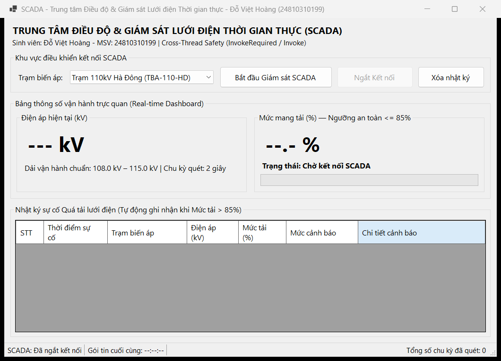
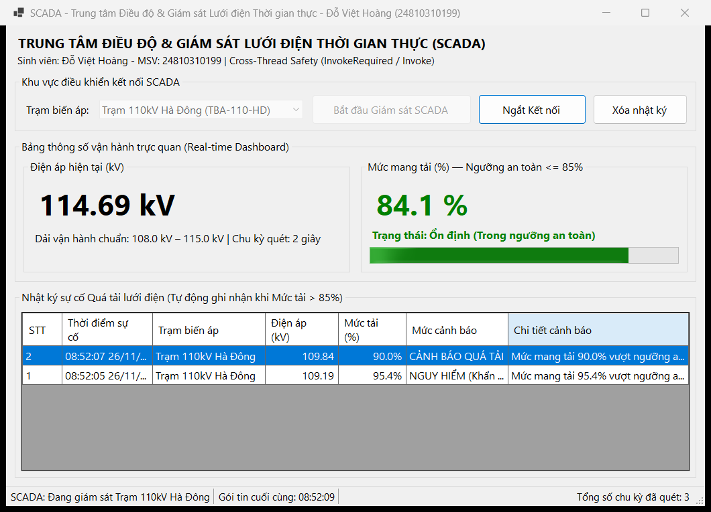
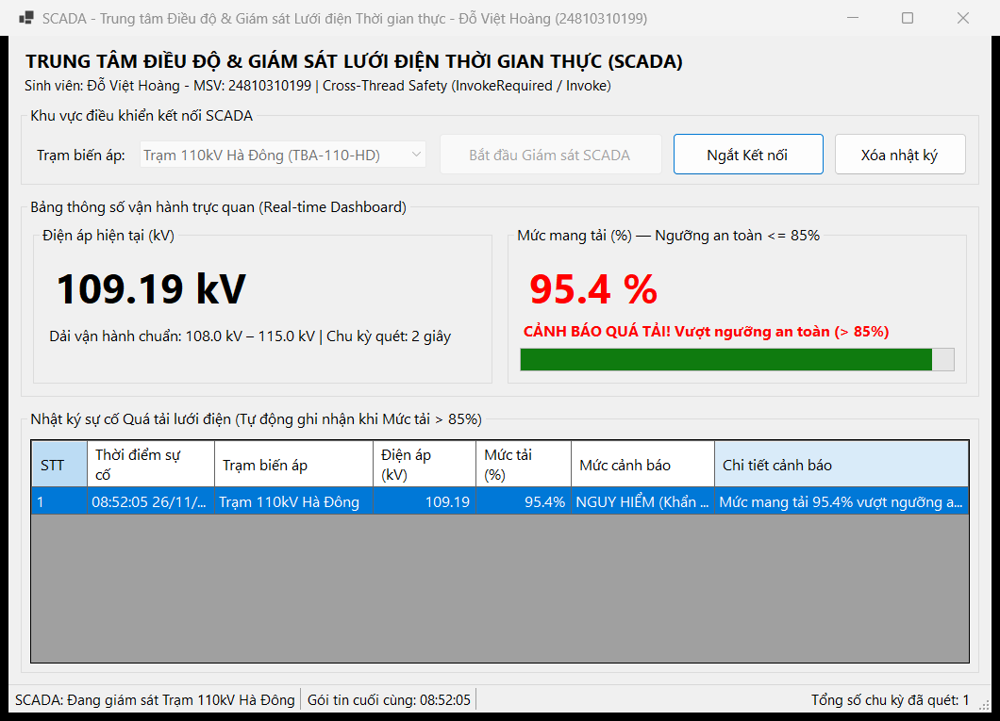
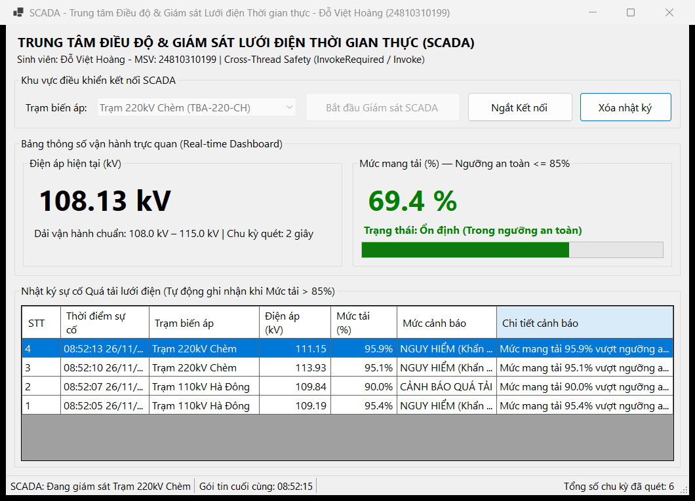
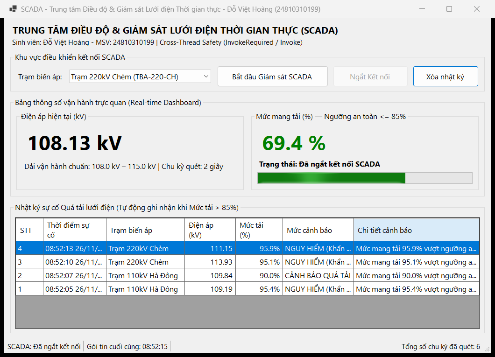

# BÀI TẬP 6.7: TRUNG TÂM ĐIỀU ĐỘ & GIÁM SÁT LƯỚI ĐIỆN THỜI GIAN THỰC (SCADA)

## Thông tin sinh viên
- **Họ và tên:** Ngô Mạnh Dũng
- **Mã sinh viên (MSV):** `24810310194`
- **Chủ đề:** Tiến trình chạy ngầm định kỳ (`Task.Run`) & An toàn đa luồng trong WinForms (**Cross-Thread Safety**: `InvokeRequired` / `Invoke`)

---

## 1. Mục tiêu kiến thức
- Xây dựng tiến trình chạy ngầm lặp định kỳ (**Background Loop**) mô phỏng hệ thống **SCADA** thu thập thông số vận hành trạm biến áp theo thời gian thực.
- Tuân thủ nghiêm ngặt quy tắc **Thread Safety** trong Windows Forms khi cập nhật dữ liệu từ Background Thread lên UI Control thông qua `this.InvokeRequired` và `this.Invoke(new Action(() => { ... }))`.
- Đảm bảo ứng dụng chạy ổn định ở chế độ Debug (**F5**) mà tuyệt đối không phát sinh ngoại lệ `InvalidOperationException: Cross-thread operation not valid`.

---

## 2. Cấu trúc Solution 3-Tier

```text
Bai6_7_GiamSatLuoiDien_SCADA/
├── Bai6_7_GiamSatLuoiDien_SCADA.sln
├── Database/
│   └── ScriptDB.sql                      # Script tạo CSDL PowerGridScadaDB và danh mục trạm biến áp
├── DTO/
│   └── ScadaModels.cs                    # SubstationDTO, TelemetryReadingDTO, GridIncidentLogDTO
├── DAL/
│   └── ScadaDAL.cs                       # SubstationDAL & GridLogDAL (Thread-safe lock)
├── BUS/
│   └── ScadaMonitorBUS.cs                # Sinh thông số SCADA (108-115 kV, 50-98%), đánh giá quá tải > 85%
├── GUI/
│   └── frmPowerGridMonitor.cs            # Real-time Dashboard, DataGridView thủ công & InvokeRequired/Invoke
├── Images/                               # 5 ảnh chụp màn hình chức năng
└── README.md
```

---

## 3. Chức năng & Kỹ thuật Cross-Thread Safety

### 3.1. Khu vực điều khiển
- `ComboBox` chọn Trạm biến áp: `Trạm 110kV Hà Đông`, `Trạm 220kV Chèm`, `Trạm 110kV Thanh Xuân`, `Trạm 220kV Đông Anh`.
- Nút **[Bắt đầu Giám sát SCADA]** khởi chạy vòng lặp nền bằng `Task.Run` kết hợp `CancellationTokenSource`.
- Nút **[Ngắt Kết nối]** dừng luồng thu thập an toàn và giải phóng `CancellationTokenSource`.

### 3.2. Khu vực bảng thông số trực quan (Real-time Dashboard)
- **`lblVoltage`**: Hiển thị Điện áp hiện tại (kV), mô phỏng ngẫu nhiên trong dải `108.00 kV – 115.00 kV` mỗi 2 giây.
- **`lblLoadPercent`**: Hiển thị Mức mang tải (`50.0% – 98.0%`):
  - Tự động đổi màu chữ sang **Đỏ** (`Color.Red`) và hiện cảnh báo quá tải khi vượt ngưỡng an toàn (`> 85%`).
  - Tự động đổi màu chữ sang **Xanh lá** (`Color.Green`) khi vận hành ổn định (`<= 85%`).
- **`StatusStrip`**: Hiển thị trạng thái kết nối SCADA, thời gian nhận gói tin cuối cùng (`HH:mm:ss`) và tổng số chu kỳ đã quét.

### 3.3. Khu vực nhật ký sự cố (`dgvGridLogs`)
- `DataGridView` (`dgvGridLogs`) được cấu hình cột **thủ công hoàn toàn bằng code** (`AutoGenerateColumns = false`).
- Tự động thêm dòng sự cố mới nhất lên đầu bảng mỗi khi trạm biến áp vượt ngưỡng `> 85%`.

### 3.4. Quy tắc Thread Safety bắt buộc
Mọi thao tác cập nhật lên `lblVoltage`, `lblLoadPercent`, `StatusStrip` và `dgvGridLogs` từ vòng lặp nền đều đi qua hàm `UpdateDashboardThreadSafe(...)`:

```csharp
if (this.InvokeRequired)
{
    this.Invoke(new Action(() => UpdateDashboardThreadSafe(reading, incident, token)));
    return;
}
```

---

## 4. Hướng dẫn cài đặt & chạy ứng dụng

1. *(Tùy chọn CSDL)* Chạy tệp `Database/ScriptDB.sql` trên SQL Server Management Studio để khởi tạo cơ sở dữ liệu mẫu.
2. Mở `Bai6_7_GiamSatLuoiDien_SCADA.sln` bằng Visual Studio 2022, chọn `PowerGridScada.GUI` làm Startup Project và nhấn **F5** (Debug Mode) để kiểm chứng không xảy ra lỗi Cross-Thread.
3. Hoặc chạy trực tiếp bằng lệnh:
   ```powershell
   dotnet run --project GUI/PowerGridScada.GUI.csproj
   ```

---

## 5. Ảnh chụp màn hình chức năng (5 ảnh)

1. **Giao diện khởi động & Chọn Trạm biến áp (`frmPowerGridMonitor`):**

   

2. **Trạng thái vận hành ổn định (Mức tải <= 85%, hiển thị Xanh lá):**

   

3. **Trạng thái Cảnh báo Quá tải (Mức tải > 85%, đổi màu Đỏ & ghi log `dgvGridLogs`):**

   

4. **Chuyển đổi giám sát Trạm 220kV Chèm & Cập nhật liên tục trên `StatusStrip`:**

   

5. **Ngắt kết nối SCADA & Xem lại toàn bộ Nhật ký sự cố Quá tải:**

   
